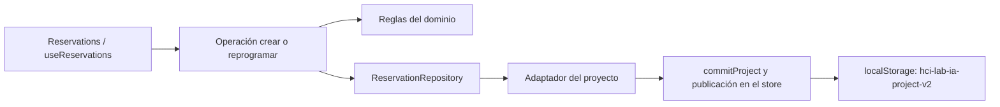

# Arquitectura

HCI Lab + IA usa React, TypeScript y Vite. Es una aplicación front-end sin base de datos: conserva el proyecto académico en `localStorage`, permite importar/exportar JSON y se publica mediante GitHub Pages.

## Capas

La [estructura del repositorio](estructura.md) asigna entrada y composición a `src/app/`, funcionalidades a `src/features/` y UI/utilidades compartidas a `src/shared/`. Las responsabilidades siguientes describen el funcionamiento existente; no requieren capas adicionales de carpetas.

1. **Dominio:** citas, personas, escenarios, hallazgos, sesiones y eventos tipados.
2. **Estado:** `ProjectProvider` aplica CRUD y persistencia local versionada.
3. **Experiencia:** flujo real, patrones, dispositivos, accesibilidad e instrumentos UX.
4. **Evaluación:** heurísticas humanas y propuestas de IA con validación o rechazo.
5. **Evidencia:** métricas derivadas, JSON del proyecto y CSV de indicadores.
6. **IA:** contrato `AiProvider`, proveedor local y adaptador para proxy seguro.
7. **Calidad:** Vitest, Testing Library, Playwright, Selenium, axe, Lighthouse y Katalon.

El proveedor de IA es simulado para evitar exponer claves. Un proveedor real debe implementar el contrato `AiProvider` mediante un servicio seguro y configurarse con `VITE_AI_PROXY_URL`. La clave permanece exclusivamente en el servidor.

## Flujo de datos

`Interacción → acción del store → localStorage → cálculo de métricas → exportación`.

Los videos LSC nunca se suben ni se conservan: la URL temporal existe solo durante la sesión. La muestra debe ser validada por una persona competente en Lengua de Señas Colombiana.

## Multimodal

`src/app/App.tsx` registra la ruta; `src/features/multimodal/MultimodalPage.tsx` coordina selección, demostraciones y evidencias. Componentes separados implementan color, comparación, smartwatch, vehículo, voz y respuestas hápticas/sonoras. `ConceptActivity.tsx` registra observaciones humanas como hallazgos. Los recursos JSON se añaden a i18next.

`ProjectState.multimodalEvidence` es opcional para mantener compatibilidad con JSON de v2. El store añade evidencias mediante actualizaciones funcionales, conserva los datos anteriores y utiliza el almacenamiento/exportación ya existente.

El modelo, el store y los respaldos se encuentran en `src/features/project/`. `src/app/i18n.ts` registra los recursos de los seis idiomas sin cambiar sus claves. Las [pruebas y sus recursos](pruebas.md) están centralizados en `tests/`.

## Arquitectura de reservas

Solo `src/features/reservations/` adopta esta separación. Los demás módulos conservan su organización y no se declaran migrados.

| Carpeta | Responsabilidad y dependencias |
|---|---|
| `domain/` | Tipo `Appointment`, servicios, campos obligatorios, fechas locales, duplicados y estados. Solo TypeScript y `Date`; devuelve códigos como `dateInvalid`, `timePast` o `duplicate`. |
| `application/` | Consultar, crear, reprogramar y cancelar. Depende del dominio y del contrato concreto `ReservationRepository`; recibe reloj e identificadores. |
| `infrastructure/` | Adapta el contrato al proyecto completo vigente. Conserva las otras colecciones y delega el guardado al mecanismo existente del store. |
| `presentation/` | Páginas, componentes y `useReservations`. Traduce códigos, controla pasos, foco y anuncios; no accede al almacenamiento. |

Por ejemplo, al confirmar una reserva, la interfaz entrega servicio, fecha, hora y condición a `create`. La operación valida sobre las reservas actuales dentro de `transact`, asigna el identificador mediante el mismo `uid` del proyecto y devuelve el registro. El adaptador guarda el proyecto completo mediante `commitProject`; solo después publica el nuevo estado y confirma éxito a la interfaz. Si falla el almacenamiento, no publica la reserva ni muestra una confirmación de guardado.

El store sigue siendo la única fuente del proyecto. Una referencia al mismo objeto mantiene disponibles los cambios más recientes mientras React publica su vista, de modo que dos comandos consecutivos no validen contra una lista antigua. Todas las actualizaciones del store pasan por esa referencia; reset y recuperación la sustituyen e invalidan los comandos de generaciones anteriores. No hay una tabla, caché de reservas, clave de almacenamiento o persistencia adicional. Las firmas antiguas `addAppointment` y `updateAppointment` delegan en las operaciones para mantener compatibilidad con consumidores existentes.

Se mantienen rutas, identificadores, `createdAt`, condiciones, historial de canceladas, respaldo versión 2, informes y preferencias. El tipo `Appointment` se reexporta desde el dominio del proyecto para no romper sus consumidores. Los seis idiomas continúan usando las claves existentes. El ejemplo multiformato conserva su validación mínima de presencia; el flujo del catálogo conserva fechas futuras y validación completa. Ambos comparten la comprobación de duplicados al guardar. La variante deliberadamente mala del ejemplo sigue siendo una demostración y no confirma reservas.

Las pruebas de reglas, operaciones y adaptador están en `tests/unit/reservation*.test.ts` y se ejecutan en Node sin React, DOM ni `localStorage`. `projectStore.test.tsx` comprueba integración, guardado fallido, escrituras consecutivas, reset y recuperación. `reservations-persistence.spec.ts` comprueba que la interfaz no confirme escrituras fallidas y permita reintentar. Los recorridos existentes cubren idiomas, temas, reservas históricas y respaldos.

Para comprobar dependencias, ejecute desde la raíz `node tests/tools/check-reservation-dependencies.cjs`. El análisis recorre imports, reexports e imports de tipos de todo `src/`, detecta ciclos y comprueba que dominio y aplicación de reservas no dependan de React, DOM, almacenamiento ni otros módulos. No añade herramientas ni dependencias.
