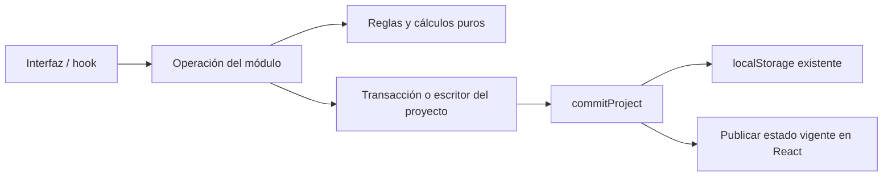

# Arquitectura

HCI Lab + IA usa React, TypeScript y Vite. Conserva un proyecto académico local, sin backend ni base de datos. Las rutas, claves de almacenamiento, identificadores y formatos de respaldo existentes se mantienen.

## Organización y dependencias

`src/app/` compone navegación, proveedores, idiomas y estilos globales. `src/features/` agrupa funcionalidades por dominio. `src/shared/` contiene UI y utilidades usadas por varios dominios; no importa funcionalidades.

Reservas sirve como referencia. Los módulos solicitados separan responsabilidades en capas con contenido concreto:

| Capa | Responsabilidad |
| --- | --- |
| `domain/` | Entidades, validaciones y cálculos puros. No importa React, DOM, traducciones, almacenamiento ni aplicación. |
| `application/` | Operaciones, entradas/salidas y contratos mínimos. Recibe persistencia, escritores, identificadores o reloj cuando los necesita. |
| `infrastructure/` | Almacenamiento, proveedores externos y adaptadores del navegador. La composición de los servicios del proyecto también reside aquí. |
| `presentation/` | Componentes, hooks, textos, foco y efectos de interfaz, con su liberación al salir. |

No se crean repositorios independientes para cada evidencia. Los módulos sin almacenamiento propio usan el escritor de evidencias del proyecto. Conceptos, patrones, evaluación y experimentos no necesitan una carpeta de infraestructura propia. Las traducciones y catálogos existentes siguen en sus módulos con las mismas claves.

Cada capa publica un `index.ts`. Los imports entre módulos usan esos puntos de entrada; los imports internos se mantienen locales. El agregado necesita únicamente el contrato `reports/domain/draft.ts`, que se importa directamente para evitar un ciclo de tipos con el catálogo de informes. `evaluation/content.ts`, `reports/format.ts` y `tracking/format.ts` son entradas de contenido o formato sin componentes ni CSS, utilizables desde Node y exportaciones. Los `index.ts` de presentación incluyen componentes y se reservan para la interfaz.

## Módulos

| Módulo | Dominio | Operaciones y adaptadores | Presentación |
| --- | --- | --- | --- |
| Reservas | Fechas, obligatoriedad, duplicados y estados | Consultar, crear, reprogramar y cancelar; adaptador del mismo proyecto | Flujo, citas y hook |
| Personas, empatía y escenarios | Procedencia, campos, nombres y vínculos antiguos | Guardar y eliminar sobre el proyecto vigente; compatibilidad explícita con ejemplos antiguos | Formularios y detalles |
| Conceptos y patrones | Puntuaciones declaradas, mediciones y observaciones | Construcción y registro de evidencias, propagando fallos | Catálogos y demostraciones |
| Evaluación | Entidades, validación de hallazgos/tareas, SUS y Raw TLX | Hallazgos, sesiones y cuestionarios | Instrumentos, registros y contenido traducido |
| Experimentos | Geometría de Fitts, ensayos y agregados | Registro de ocho mediciones, sin incluir la práctica | Objetivos, eventos, reloj y controles |
| IA y chatbots | Revisión, incorporación, progresión de respuesta y rúbrica | Incorporación explícita y evidencia humana; contrato de proveedor, proxy/local y temporizador como adaptadores | Propuestas, conversación y decisiones |
| Seguimiento y multimodal | Geometría, muestras acotadas, validación de mirada, comandos y estados | Sesiones/evidencias sobre el proyecto; coordenadas DOM y WebGazer como adaptadores | Captura, cámara, mapas, voz y simuladores |
| Informes | Colecciones, comparaciones compatibles, unidades y bloques | Guardado explícito de borrador y exportación con renderizador/escritor recibidos | Filtros, formatos traducidos y vista imprimible |
| Proyecto y accesibilidad | Agregado, preferencias, validación de respaldos y desplazamiento motriz | Evidencias, eventos, reset, recuperación y checklist; almacenamiento y recursos sensoriales aislados | Proveedor React, diálogo y demostraciones |

Dashboard, dispositivos, métricas, curso y calidad conservan sus pantallas existentes y consumen las entradas públicas actualizadas. No se presentan como migraciones adicionales.

## Estado y persistencia

El único agregado es `ProjectState`. `ProjectProvider` mantiene el objeto vigente en una referencia y publica su vista en React. `createProjectServices` compone las operaciones; `ProjectRepository.transact` aplica cada cambio sobre el objeto vigente, persiste y solo entonces publica el resultado. Reservas conserva su contrato específico y adapta el mismo agregado. No hay almacenamiento secundario de reservas ni de evidencias.

Todas las escrituras de almacenamiento están en `features/project/infrastructure/storage.ts`. Se mantienen `hci-lab-ia-project-v2`, `hci-prefs-v2` y `hci-language`, los datos de proyecto versión 2 y los metadatos de respaldo versión 1. `commitProject` conserva su restauración de claves anteriores si falla una sustitución con preferencias.

Las operaciones consecutivas observan las anteriores antes del siguiente render. La inicialización no reescribe una instantánea antigua si un efecto hijo ya ejecutó un comando. Una escritura fallida devuelve fallo, conserva memoria y almacenamiento anteriores, mantiene los borradores y permite reintentar. Los componentes confirman guardado solo después del éxito. Los borradores de informes conservan su guardado explícito y formato; guardarlos combina el borrador con el agregado vigente.

Reset y recuperación persisten antes de sustituir el agregado, incrementan la generación y rechazan los comandos anteriores. La lectura asíncrona de un respaldo también comprueba si sigue vigente. Se mantienen los ejemplos didácticos y las políticas de datos antiguos; los métodos de compatibilidad no imponen retroactivamente requisitos nuevos a esos ejemplos.

Por ejemplo, guardar una persona ejecuta `research.savePersona`: valida sobre las personas y escenarios actuales, conserva o actualiza sus vínculos y solicita una transacción del proyecto. El adaptador guarda el agregado mediante `commitProject`. Solo si termina correctamente la interfaz vuelve a la lista y anuncia el guardado. Reservas sigue el mismo recorrido con `ReservationRepository`.

## Navegador, recursos y exportaciones

Los temporizadores y eventos permanecen en adaptadores o efectos de presentación. La geometría, el muestreo, las puntuaciones y la validación de mirada pueden probarse sin navegador ni cámara. WebGazer sigue siendo un adaptador opcional; la mirada y las rutas simuladas se conservan separadas. Reset y las salidas de pantalla liberan los recursos existentes de cámara, micrófono, voz y temporizadores.

Las demostraciones de IA siguen siendo locales y requieren revisión humana. El contrato `AiProvider` y sus implementaciones existentes quedan separados; el proxy opcional usa `VITE_AI_PROXY_URL` y no incorpora claves en el cliente. No se añade una conexión ni un backend.

Los formatos Markdown, CSV, JSON e impresión conservan nombres y contenido. Los renderizadores traducidos se suministran a la operación de exportación; dominio y aplicación no importan traducciones. El escape CSV realmente compartido está en `shared/csv.ts`; la descarga DOM permanece en `shared/files.ts`.

## Verificación y límites

Las pruebas y recursos exclusivos están en `tests/`. Las reglas y operaciones nuevas se prueban en Node; la integración comprueba fallos, reintentos, comandos consecutivos y generaciones invalidadas. Los E2E cubren idiomas, temas, teclado, disposición visual, reset, recuperación y exportaciones.

Ejecute `node tests/tools/check-architecture.cjs` para analizar imports y reexports, incluidos tipos y dependencias transitivas. Comprueba ciclos, aislamiento de dominio/aplicación, entradas públicas y que `shared/` no dependa de funcionalidades. No resuelve imports construidos mediante cadenas en ejecución.

El [registro de migración y verificaciones](historico/informes/arquitectura-dominios.md) distingue resultados automáticos y revisiones manuales pendientes. Cámara, audio, háptica y reconocimiento físicos, lectores de pantalla y validación de LSC requieren comprobación manual. No se añade sincronización entre pestañas, CRUD de usuarios ni nuevas funcionalidades.
